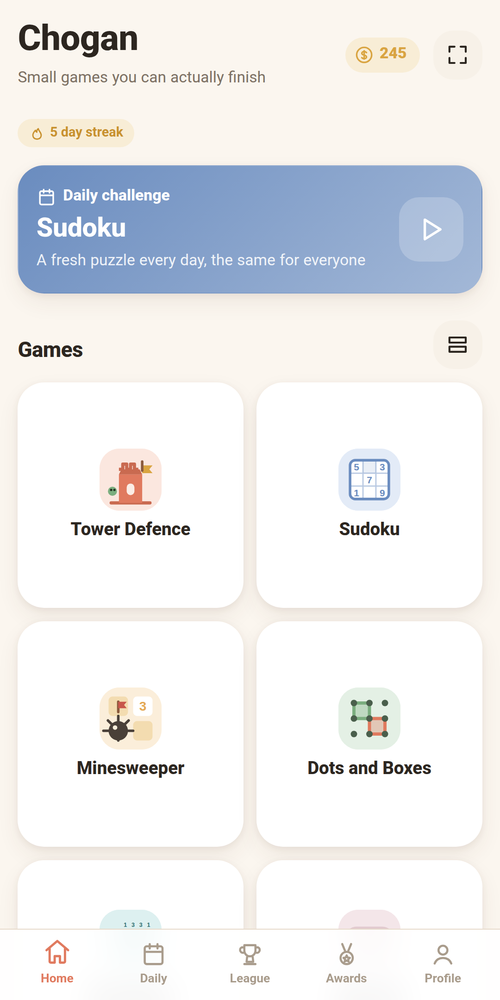
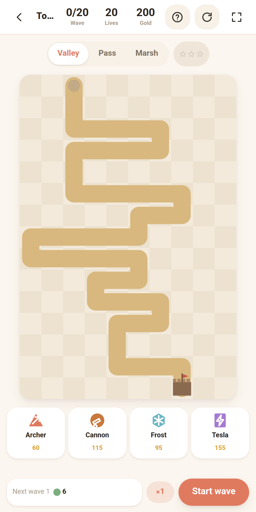
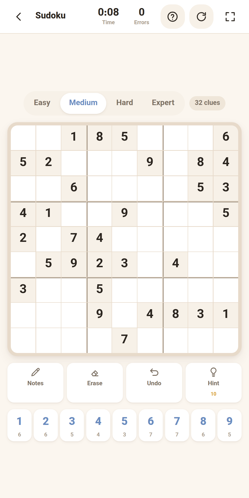
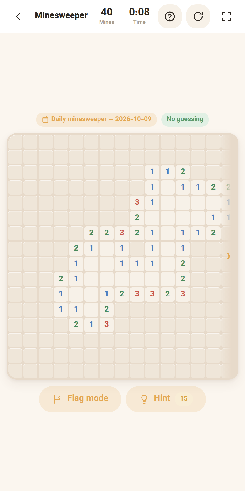
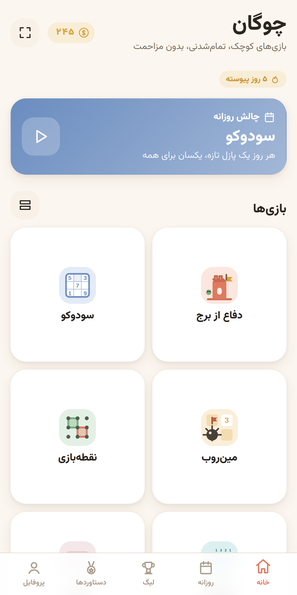
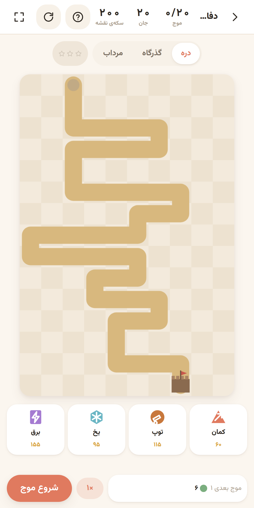
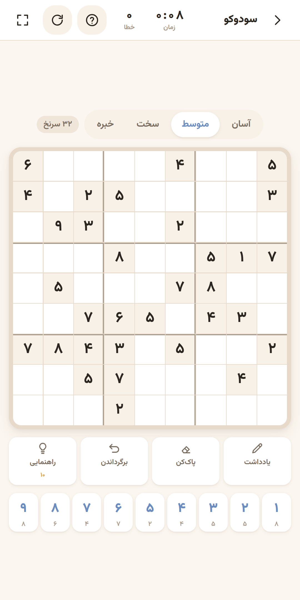
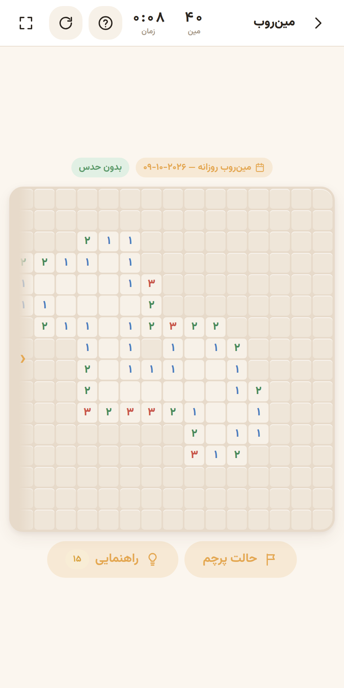

# Chogan — چوگان

## English

Chogan is a small collection of finishable games in a single app. Free, open source, no ads, no in-app purchases, no analytics or trackers, and fully offline.

Ways to play:
- **Web:** [choganhq.github.io/chogan](https://choganhq.github.io/chogan/), installable as an app from the browser.
- **Android:** [F-Droid](https://f-droid.org/packages/io.github.choganhq.chogan/), or the APK on the [Releases page](https://github.com/choganhq/chogan/releases).
- **Telegram:** [@chogangamebot](https://t.me/chogangamebot) opens the web version inside Telegram.
- **News:** every release is announced in the Telegram channel [@chogan_games](https://t.me/chogan_games).

<p>




</p>

### The games

| Game | About |
| --- | --- |
| Tower Defence | Four towers, six fixed maps plus a daily map, twenty waves and an endless mode |
| Sudoku | Four difficulties with a guaranteed unique solution, notes, hints and a daily challenge |
| Minesweeper | No-guess generation, four sizes, chording and flags, daily challenge |
| Dots and Boxes | Two players on one phone, or three levels of AI |
| Backgammon | Two players or three levels of AI, dice that undo can never re-roll, gammons count double |
| Mancala | Kalah rules, two players or three levels of AI |
| Nonogram | Three sizes, every puzzle solvable by logic alone |
| FreeCell | The classic numbered deals, never the one unwinnable deal, unlimited undo |
| Reversi | Two players or three levels of AI |
| Nine Men's Morris | Two players or three levels of AI |
| Peg Solitaire | Leave one peg, in the centre for a perfect game |
| Battleship | Against an AI that only knows what you would know |
| Bridges | Three sizes, every puzzle with exactly one solution |
| Code Breaker | Three levels, colour-blind friendly |
| Breakout | Twelve fixed levels, three balls each |
| Pasur | The Persian card game of making eleven, against three levels of AI |
| Mahjong Solitaire | Small, medium and turtle layouts, every deal solvable, pinch to zoom on the turtle |
| Chess | Two players or three levels of AI, plus 600 puzzles; the daily challenge is three puzzles |
| Hokm | Four players in two teams, you and three AI players at three levels, matches to 3 or 7 |
| Block Drop | Falling blocks: a 40-line sprint and a 100-line marathon, with hold and three next pieces |
| Gomoku | Five in a row on a 9, 13 or 15 board, two players or three levels of AI, and a daily game; with [@lanlan3292](https://github.com/lanlan3292) |
| Go | Go on a 9×9 board with area scoring and automatic dead-stone counting, two players or three levels of AI, and a daily game |
| Way Out | Send every arrow off the board in a working order, three hearts a level, levels without end; by [@ggYasin](https://github.com/ggYasin) |
| Blackjack | Closer to 21 than the dealer: ten-hand matches with no betting, hit/stand advice and a daily game |
| 8-Ball Pool | Eight-ball pool with real table physics: pot your group, then the 8; aim at your finger and pull back the white ball or the cue, or turn the cue finely and shoot with the power bar; against three levels of AI or two players, and a daily clear-the-table challenge |
| Snooker | Snooker on the same table physics: a red, then a colour, then the colours in order, with 6, 10 or 15 reds, against three levels of AI or two players, and a daily three-red clearance |
| Gridlock | Slide the cars out of the way and drive yours out of the lot, one drag a move, levels without end and a daily puzzle; by [@ggYasin](https://github.com/ggYasin) |
| Chain Reaction | Add orbs until cells burst and chain across the board; the last colour left wins, 2 to 4 players on one phone or against bots, and a daily game |
| Ludo | Roll, come out on a six, capture and race your tokens home; a quick game with two tokens each or the full one with four, 2 to 4 players or against bots, and a daily game |
| Snakes and Ladders | Roll, climb the ladders, slide down the snakes and reach 100 first, on our own board; 2 to 4 players on one phone or against bots, with an optional exact finish |
| Darts | 501 or 301 with three darts a turn and a double to finish; aim with a wobbling hand, against a bot at three levels or two players, and a daily 301 in as few darts as you can |
| Bowling | Ten frames on a lane seen from behind: swipe to bowl, bend the swipe for spin, and pins that carry like real ones; alone, against a bot at three levels or two players, and a daily lane |
| Sliding Puzzle | Slide the numbered tiles back into order on a 3×3, 4×4 or 5×5 tray, every shuffle solvable, in as few moves as you can, and a daily tray |
| Jigsaw | Drag pieces up from a scrolling row into the frame, 12, 24, 48 or 96 of them (150 on a big screen), where each one snaps into its own place; a hundred pictures of our own drawn in code (Persian patterns, scenes, still lifes and animals), a new one each game until all are done, and a daily picture |
| Checkers | Draughts on 8×8 with three rule sets: classic checkers (English draughts), with compulsory jumps that run to the end and kings that step backwards too, Spanish draughts, with flying kings and the capture that takes the most pieces, or Huevo Style by [@HuevosKicker](https://github.com/HuevosKicker), with a Queen to protect, an Empress, captures that may stop after any landing and an edge clock; against the AI at three levels or two players, and a daily classic game from a seeded opening against the hard AI |
| Klondike | Classic solitaire, drawing one or three cards from the stock with unlimited passes; tap a card to send it to its best place or drag it, unlimited undo, the last cards go home by themselves, and a daily deal that our own solver has won before it is offered |
| Crazy Eights | Match the top card by suit or rank and empty your hand first. By default the Iranian Haft Khabis rules: the jack is wild, a seven makes the next player draw two (sevens stack), an eight plays again, a ten reverses, an ace skips; the international rules, with eights wild, are a choice behind the gear. Against 1 to 3 bots at three levels, a match to 100 points, and a daily round dealt the same for everyone |
| Gin Rummy | Ten cards each against a bot at three levels: draw from the stock or take the upcard, make sets and runs, knock at 10 or less deadwood, gin and undercut bonuses, lay-offs at the showdown, a match to 100; drag to reorder your hand or tap Arrange, and a daily hand dealt the same for everyone |
| Shelem | The Iranian partnership game: you and a bot partner against two bots, twelve cards each, bids from 100 to 165 in fives, the declarer takes the four-card widow, puts four back and names trump; aces and tens 10, fives 5, every trick 5, a shelem (every trick) 330; three levels, a match to 505 or 1165, and a daily hand dealt the same for everyone |
| Spider | Two decks in ten columns: build each suit from king down to ace and a full run leaves by itself; one, two or four suits, a tap sends a run to its best place or drag it, a hint, unlimited undo, and a daily one-suit deal dealt the same for everyone |
| Pairs | The memory game: every picture twice, face down; turn two cards at a time and find every pair in as few moves as you can, on a 4×4, 4×6 or 6×6 table, with eighteen pictures that differ in shape and colour, no clock, and a daily table the same for everyone |
| Gorillas | Two gorillas on a skyline drawn in code take turns throwing an exploding banana: angle, power, gravity and wind, and every hit bites a hole in the city; aim by dragging like a slingshot, with numbers as in the original, or with a joystick, against three levels of bot or two players on one phone, first to three rounds, every city winnable, and a daily match against the medium bot |
| Hop | Bounce up from platform to platform without falling: plain, moving, crumbling and spring platforms, the world wraps at the sides, and the gaps grow but always stay within a jump; steer by holding the left or right half of the screen or by tilting the phone, endless with a best height, and a daily climb to a summit at 2,000 m |
| Tanks | Two tanks on hills drawn in code fire in turns: angle, power, gravity and a wind that changes every turn; blasts dig out the ground and the earth above falls in; five weapons (shell, heavy, triple, roller, dirt) and four moves a match; scored by damage over ten shots each, against three levels of bot or two players on one phone, both aim controls behind the gear, and a daily match against the medium bot |
| Chinese chess | Chinese chess (xiangqi) on a 9×10 board between two palaces: the general and his advisors never leave the palace, elephants never cross the river, horses are blocked at the leg, cannons capture over exactly one piece, and the two generals may never face each other on an open file; checkmate and stalemate both lose and a threefold repetition draws. Against the AI at three levels or two players, unlimited undo, and a daily game dealt the same for everyone; by [@lanlan3292](https://github.com/lanlan3292) |
| Ping Pong | Table tennis seen from above: the ball bounces off the sides of the table, where it meets the paddle sets the angle of the return, and every hit is a little faster; two serves each, one each from ten all, first to 11 by two; against three levels of bot or two players on one phone, each on their own half, and a daily match against the medium bot |
| Air Hockey | Air hockey seen from above on a neon table drawn in code: move your mallet in your own half and hit the puck off the boards into the other goal, the faster the hit the faster the shot; after a goal the puck goes to the player who let it in; first to seven, against three levels of bot or two players on one phone, each on their own half, and a daily match against the medium bot |
| Echo | The memory game known as Simon: four coloured pads round a disc light up in turn, each with its own note, and you repeat the order; every round adds one more and plays a little faster, the first mistake ends it, and nothing is timed; each pad also has its own shape for colour blindness; endless with a best score, and a daily sequence the same for everyone |
| Lights Off | The puzzle known as Lights Out: pressing a light switches it and its four neighbours, and the goal is to put every light out; 3×3, 5×5 and 7×7 boards, each made solvable and showing the fewest moves it needs, found by an exact solver; the fewest moves earn three stars and extra moves only cost stars, never the game; undo and restart, and a daily 5×5 puzzle the same for everyone |

Around the games: search by name, pinned and recently played games and a row of new ones at the top of the menu, long-press shortcuts to games on the app icon, a daily challenge that is identical on every device with no server at all, a weekly offline league with five tiers, over 150 awards, a shared coin that is only ever spent on hints and cosmetics, stats and a profile, and a Persian, English, Simplified Chinese, German and Spanish interface with light and dark themes.

### Why Chogan

Chogan (چوگان) is the Persian name of the game known today as polo: a team game on horseback, where the ball is struck towards the goal with a crooked stick, itself called a chogan. It is one of the oldest team games and was played in Iran for centuries; the stone goalposts still stand in Naqsh-e Jahan Square in Isfahan. We chose the name because it is an Iranian name, and because chogan, for all its simplicity, just a stick and a ball, can be a real challenge. That is what the games in this app want to be.

### Why it needs no permissions

The Android manifest declares `VIBRATE` and nothing else — not even internet access, because nothing in the app ever touches the network. Fonts, sounds and every asset ship inside the package; sound is generated procedurally with WebAudio, so there is not a single audio file in the build. Progress is stored on the device only, and Google auto-backup is turned off.

### Building

The web version needs no build step:

```bash
python3 -m http.server -d www 8000
```

For a clean browser with no progress or service worker cache left over from an earlier run, use `tools/dev.sh`. It serves the same files, opens Chrome with a throwaway profile that is deleted when you close it, and never writes into `www/`. `tools/dev.sh --seed` also skips the first-run welcome and adds invented demo state.

The Android version needs Gradle only — no Node, no npm, no `node_modules`:

```bash
cd android && gradle assembleDebug
```

Capacitor's runtime is pulled from Maven Central as `com.capacitorjs:core`, and a Gradle task named `syncWebAssets` replaces `npx cap sync`.

### Testing

```bash
node tools/test.js
tools/browser-check.sh
```

The tests extract each game engine from the published HTML file itself, between the `ENGINE START` and `ENGINE END` markers, so no second copy of the code exists for testing.

### Adding a game

See [NEW_GAME.md](NEW_GAME.md). In short: one folder under `www/games/`, one entry in `games.json`, bump the version.

### Both sources ship the same signed APK

Chogan is published on F-Droid as a [reproducible build](https://f-droid.org/docs/Reproducible_Builds). F-Droid rebuilds it from source, compares the result to the APK attached to the GitHub release, and when they match it publishes **our** signed file rather than re-signing with its own key.

So both sources carry the identical, identically-signed APK. You can install from either one and switch later without uninstalling, and your progress survives.

### License

MIT, see [LICENSE](LICENSE). The Vazirmatn font is under the OFL; its licence text ships beside the font in `www/fonts/OFL.txt`.

---

<div dir="rtl">

## فارسی

مجموعه‌بازی چوگان: چند بازی کوچک و تمام‌شدنی در یک اپ. رایگان، متن‌باز، بدون تبلیغ، بدون خرید درون‌برنامه‌ای، بدون تحلیل‌گر و ردیاب، و کاملاً آفلاین.

راه‌های بازی:
- **وب:** [choganhq.github.io/chogan](https://choganhq.github.io/chogan/)، که از مرورگر مثل یک اپ نصب می‌شود.
- **اندروید:** از [اف‌دروید](https://f-droid.org/packages/io.github.choganhq.chogan/)، یا فایل APK از بخش [Releases](https://github.com/choganhq/chogan/releases).
- **تلگرام:** [@chogangamebot](https://t.me/chogangamebot) نسخه‌ی وب را داخل تلگرام باز می‌کند.
- **خبرها:** هر نسخه‌ی تازه در کانال تلگرام [@chogan_games](https://t.me/chogan_games) (به انگلیسی) اعلام می‌شود.

<p>




</p>

### بازی‌ها

| بازی | توضیح |
| --- | --- |
| دفاع از برج | چهار برج، شش نقشه‌ی ثابت به‌علاوه‌ی نقشه‌ی روزانه، بیست موج و حالت بی‌پایان |
| سودوکو | چهار سختی با جواب یکتای تضمین‌شده، یادداشت، راهنمایی و چالش روزانه |
| مین‌روب | تولید بدون حدس، چهار اندازه، کورد و پرچم، چالش روزانه |
| نقطه‌بازی | دو نفره روی یک گوشی یا مقابل هوش مصنوعی با سه سطح |
| تخته‌نرد | دو نفره یا مقابل هوش مصنوعی با سه سطح، تاسی که با برگرداندن عوض نمی‌شود، مارس دو برابر |
| منقله | قانون کلاه، دو نفره یا مقابل هوش مصنوعی با سه سطح |
| نونوگرام | سه اندازه، هر جدول فقط با منطق حل می‌شود |
| فری‌سل | دست‌های شماره‌دار کلاسیک، هرگز دست بی‌جواب، برگرداندن بی‌حد |
| ریورسی | دو نفره یا مقابل هوش مصنوعی با سه سطح |
| دوز | دو نفره یا مقابل هوش مصنوعی با سه سطح |
| میخ‌پران | یک میخ بماند، در مرکز یعنی بی‌نقص |
| نبرد دریایی | مقابل حریفی که فقط همان را می‌داند که تو می‌دانی |
| پل‌ها | سه اندازه، هر جدول دقیقاً یک جواب |
| رمزشکن | سه سطح، مناسب کوررنگی |
| آجرشکن | دوازده مرحله‌ی ثابت، سه توپ در هر مرحله |
| پاسور | بازی ورق ایرانیِ یازده‌سازی، مقابل هوش مصنوعی با سه سطح |
| ماهجونگ | سه چیدمان کوچک، متوسط و لاک‌پشت، هر دست حل‌شدنی، بزرگ‌نمایی با دو انگشت روی لاک‌پشت |
| شطرنج | دو نفره یا مقابل هوش مصنوعی با سه سطح، به‌علاوه‌ی ۶۰۰ معما؛ چالش روزانه سه معماست |
| حکم | چهار نفر در دو تیم، تو و سه بازیکن هوش مصنوعی با سه سطح، بازی تا ۳ یا ۷ |
| بلوک‌ریز | بلوک‌های ریزان: سرعتی ۴۰ خط و ماراتن ۱۰۰ خط، با نگه داشتن قطعه و سه قطعه‌ی بعدی |
| گوموکو | پنج در یک خط روی تخته‌ی ۹، ۱۳ یا ۱۵، دو نفره یا مقابل ربات با سه سطح، و بازی روزانه؛ با همکاری [@lanlan3292](https://github.com/lanlan3292) |
| گو | گوی ۹×۹ با شمارش زمین و تشخیص خودکار سنگ‌های مرده، دو نفره یا مقابل ربات با سه سطح، و بازی روزانه |
| راه دررو | همه‌ی پیکان‌ها را به ترتیب درست از تخته بیرون بفرست، سه جان در هر مرحله، مرحله‌های بی‌پایان؛ ساخته‌ی [@ggYasin](https://github.com/ggYasin) |
| بیست‌ویک | نزدیک‌تر از دیلر به ۲۱: مسابقه‌ی ده‌دستی بدون شرط‌بندی، با پیشنهاد حرکت و بازی روزانه |
| بیلیارد | بیلیارد هشت‌توپ با فیزیک واقعی میز: توپ‌های دسته‌ات و بعد توپ ۸ را بینداز؛ نشانه به سمت انگشت و عقب کشیدن توپ سفید یا چوب، یا چرخاندن ریز چوب و ضربه با نوار قدرت؛ با ربات در سه سطح یا دو نفره، و چالش روزانه‌ی پاک کردن میز |
| اسنوکر | اسنوکر با همان فیزیک میز: یک سرخ، یک رنگی و آخر رنگی‌ها به ترتیب، با ۶، ۱۰ یا ۱۵ سرخ، با ربات در سه سطح یا دو نفره، و چالش روزانه‌ی پاک کردن میز سه‌سرخه |
| راه‌بندان | ماشین‌ها را کنار بزن و ماشینت را از پارکینگ بیرون ببر، هر کشیدن یک حرکت، مرحله‌های بی‌پایان و بازی روزانه؛ ساخته‌ی [@ggYasin](https://github.com/ggYasin) |
| واکنش زنجیره‌ای | گوی بگذار تا خانه‌ها بترکند و زنجیروار پخش شوند؛ آخرین رنگ برنده است، ۲ تا ۴ نفر روی یک گوشی یا با ربات، و بازی روزانه |
| منچ | تاس بریز، با شش بیرون بیا، حریف را بزن و مهره‌هایت را به خانه برسان؛ بازی سریع با دو مهره یا کامل با چهار مهره، ۲ تا ۴ نفر یا با ربات، و بازی روزانه |
| مار و پله | تاس بریز، از نردبان بالا برو، از مار پایین بیا و اول به ۱۰۰ برس، روی صفحه‌ی خود ما؛ ۲ تا ۴ نفر روی یک گوشی یا با ربات، با پایان دقیق به انتخاب |
| دارت | ۵۰۱ یا ۳۰۱، سه دارت در هر نوبت و پایان روی دوبرابر؛ با دستی که کمی می‌لرزد نشانه بگیر، با ربات در سه سطح یا دو نفره، و چالش روزانه‌ی ۳۰۱ با کمترین دارت |
| بولینگ | ده فریم روی مسیری که از پشت دیده می‌شود: انگشت بکش تا پرتاب کنی، کج بکش تا پیچ بخورد، و پین‌هایی که مثل واقعی می‌افتند؛ تنها، با ربات در سه سطح یا دو نفره، و مسیر روزانه |
| پازل کشویی | کاشی‌های شماره‌دار را روی سینی ۳×۳، ۴×۴ یا ۵×۵ با سُر دادن به ترتیب بچین، همه‌ی چیدمان‌ها حل‌شدنی، با کمترین حرکت، و سینی روزانه |
| جورچین | تکه‌ها را از ردیفی که به پهلو می‌لغزد بالا بکش و در قاب بگذار، ۱۲، ۲۴، ۴۸ یا ۹۶ تکه (و ۱۵۰ روی صفحه‌ی بزرگ)، که هر کدام فقط سر جای خودش می‌چسبد؛ صد تصویر از خود ما که با کد کشیده شده‌اند (نقش‌های ایرانی، منظره، طبیعت بی‌جان و جانوران)، هر بار تصویری که هنوز تمامش نکرده‌ای، و تصویر روزانه |
| چکرز | چکرز روی تخته‌ی ۸×۸ با سه قانون: کلاسیک (درافتس انگلیسی) با زدن اجباری که باید تا آخر ادامه پیدا کند و شاهی که به عقب هم می‌رود، اسپانیایی با شاه پرنده و زدنی که بیشترین مهره را بگیرد، یا سبک هوئوو ساخته‌ی [@HuevosKicker](https://github.com/HuevosKicker) با ملکه‌ای که باید از او محافظت کرد، امپراتریس، زنجیره‌هایی که بعد از هر فرود می‌توانند بایستند و ساعت لبه؛ مقابل هوش مصنوعی در سه سطح یا دو نفره، و بازی روزانه‌ی کلاسیک از یک گشایش ثابت مقابل حریف سخت |
| سالیتر | سالیتر کلاسیک با برداشتن یک یا سه کارت از دسته و دور زدن بی‌حد؛ کارت را بزن تا به بهترین جا برود یا بکشش، برگرداندن بی‌حد، کارت‌های آخر خودشان به پایه می‌روند، و دست روزانه‌ای که حل‌کننده‌ی خود بازی پیش از دادنش برده است |
| هفت خبیث | هم‌خال یا هم‌عدد کارت روی زمین بازی کن و زودتر دستت را خالی کن. پیش‌فرض قانون ایرانی است: سرباز خال را عوض می‌کند، هفت نفر بعد را دو کارت جریمه می‌کند (هفت‌ها روی هم جمع می‌شوند)، هشت یک کارت دیگر، ده جهت را برعکس و آس نوبت نفر بعد را می‌سوزاند؛ قانون بین‌المللی (هشت دیوانه) پشت چرخ‌دنده است. مقابل ۱ تا ۳ ربات در سه سطح، مسابقه تا ۱۰۰ امتیاز، و دست روزانه‌ای که برای همه یکی است |
| جین رامی | ده کارت مقابل یک ربات در سه سطح: از دسته یا کارت رو بردار، دسته‌ی هم‌عدد یا پشت سر هم بساز، با ۱۰ یا کمتر ناک کن، جایزه‌ی جین و آندرکات، چسباندن کارت در پایان دست، مسابقه تا ۱۰۰؛ کارت‌ها را بکش و مرتب کن یا «مرتب کن» را بزن، و دست روزانه‌ای که برای همه یکی است |
| شلم | بازی دونفره‌ی تیمی ایرانی: تو و یار رباتت مقابل دو ربات، دوازده کارت به هر نفر، خواندن از ۱۰۰ تا ۱۶۵ پنج‌تا‌پنج‌تا، خواننده چهار کارت وسط را برمی‌دارد، چهار کارت می‌خواباند و حکم را می‌گوید؛ آس و ده ۱۰، پنج ۵، هر دست ۵ و شلم (همه‌ی دست‌ها) ۳۳۰؛ سه سطح، مسابقه تا ۵۰۵ یا ۱۱۶۵، و دست روزانه‌ای که برای همه یکی است |
| عنکبوت | دو دست ورق در ده ستون: هر خال را از شاه تا آس پشت سر هم بچین تا ردیف کامل خودش برداشته شود؛ یک، دو یا چهار خال، با یک ضربه یا کشیدن، راهنمایی، برگرداندن بی‌حد و دست روزانه‌ی یک‌خال که برای همه یکی است |
| جفت‌ها | بازی حافظه: هر نقش دو بار، پشت‌ورو؛ دو کارت دو کارت برگردان و همه‌ی جفت‌ها را با کمترین حرکت پیدا کن، روی میز ۴×۴، ۴×۶ یا ۶×۶، با هجده نقش که هم شکلشان فرق دارد هم رنگشان، بدون ساعت، و میز روزانه‌ای که برای همه یکی است |
| گوریل‌ها | دو گوریل روی شهری که با کد کشیده شده به نوبت موز منفجره پرت می‌کنند: زاویه، قدرت، جاذبه و باد، و هر برخورد تکه‌ای از شهر را می‌کند؛ نشانه‌گیری با کشیدن مثل فلاخن، با عدد مثل بازی اصلی یا با دسته، مقابل ربات در سه سطح یا دونفره روی یک گوشی، سه دست برد، هر شهر بردنی، و مسابقه‌ی روزانه با ربات متوسط |
| جهش | از سکو به سکو بالا برو و نیفت: سکوی معمولی، متحرک، شکننده و فنری، دو طرف صفحه به هم راه دارند، و فاصله‌ها بیشتر می‌شوند ولی همیشه در دسترس یک پرش می‌مانند؛ کنترل با نگه داشتن نیمه‌ی چپ یا راست صفحه یا کج کردن گوشی، بی‌پایان با رکورد ارتفاع، و صعود روزانه تا قله‌ای در ۲۰۰۰ متر |
| تانک‌ها | دو تانک روی تپه‌هایی که با کد کشیده شده‌اند به نوبت شلیک می‌کنند: زاویه، قدرت، جاذبه و بادی که هر نوبت عوض می‌شود؛ انفجار زمین را می‌کند و خاک بالایش فرو می‌ریزد؛ پنج نوع موشک (گلوله، سنگین، سه‌تایی، غلتان، خاک) و چهار حرکت در هر مسابقه؛ امتیاز با آسیب در ده شلیک برای هر نفر، مقابل ربات در سه سطح یا دونفره، هر دو نوع نشانه‌گیری پشت چرخ‌دنده، و مسابقه‌ی روزانه با ربات متوسط |
| شطرنج چینی | شطرنج چینی روی صفحهٔ ۹×۱۰ میان دو کاخ: شاه و مشاور هرگز از کاخ بیرون نمی‌روند، پیل از رودخانه نمی‌گذرد، اسب را مهرهٔ کنار پایش می‌بندد، توپ فقط از روی یک مهره می‌گیرد و دو شاه هرگز رو‌به‌روی هم نمی‌ایستند؛ کیش‌ومات و پات هر دو باخت‌اند و تکرار سه‌باره مساوی است. مقابل هوش مصنوعی در سه سطح یا دو نفره، برگرداندن بی‌حد، و بازی روزانه‌ای که برای همه یکی است؛ ساخته‌ی [@lanlan3292](https://github.com/lanlan3292) |
| پینگ‌پنگ | تنیس روی میز از بالا: توپ از دو لبه‌ی میز برمی‌گردد، جایی از راکت که توپ به آن می‌خورد زاویه‌ی برگشت را تعیین می‌کند و هر ضربه کمی تندتر است؛ هر نفر دو سرویس و از ده‌ده یک سرویس، تا ۱۱ با دو امتیاز اختلاف؛ مقابل ربات در سه سطح یا دونفره روی یک گوشی، هر کس روی نیمه‌ی خودش، و مسابقه‌ی روزانه با ربات متوسط |
| ایرهاکی | ایرهاکی از بالا روی میز نئونی که با کد کشیده شده: دسته‌ات را در نیمه‌ی خودت حرکت بده و توپک را با کمک دیواره‌ها به دروازه‌ی حریف بزن، هر چه ضربه تندتر، شوت تندتر؛ بعد از هر گل توپک به نیمه‌ی کسی می‌رود که گل خورده؛ اول هفت گل، مقابل ربات در سه سطح یا دونفره روی یک گوشی، هر کس روی نیمه‌ی خودش، و مسابقه‌ی روزانه با ربات متوسط |
| سایمون | بازی حافظه‌ی سایمون: چهار دکمه‌ی رنگی دور یک دایره به نوبت روشن می‌شوند، هر کدام با صدای خودش، و تو همان ترتیب را تکرار می‌کنی؛ هر دور یکی بیشتر و کمی تندتر، اولین اشتباه پایان بازی است و برای تکرار وقت نمی‌گیرد؛ هر دکمه شکل خودش را هم دارد تا بدون رنگ هم شناخته شود؛ بی‌پایان با رکورد، و ترتیب روزانه‌ای که برای همه یکی است |
| خاموشی | پازل معروف Lights Out: زدن هر چراغ خودش و چهار همسایه‌اش را عوض می‌کند و هدف خاموش کردن همه‌ی چراغ‌هاست؛ صفحه‌های ۳×۳، ۵×۵ و ۷×۷، همه حل‌شدنی و با کمترین تعداد حرکتی که حل‌کننده‌ی دقیق پیدا کرده؛ کمترین حرکت سه ستاره دارد و حرکت اضافه فقط ستاره کم می‌کند، نه اینکه ببازی؛ برگرداندن و شروع دوباره، و پازل ۵×۵ روزانه‌ای که برای همه یکی است |

بیرون از بازی‌ها: جست‌وجوی بازی با نام، بازی‌های سنجاق‌شده، اخیراً بازی‌شده و ردیف بازی‌های تازه بالای منو، میان‌بر بازی‌ها با نگه داشتن آیکون اپ، چالش روزانه‌ی مشترک برای همه‌ی دستگاه‌ها بدون هیچ سروری، لیگ هفتگی آفلاین با پنج رده، بیش از ۱۵۰ دستاورد، سکه‌ی مشترک که فقط خرج راهنمایی و تزئینات می‌شود، آمار و پروفایل، و رابط فارسی، انگلیسی، چینی ساده‌شده، آلمانی و اسپانیایی با تم روشن و تاریک.

### چرا چوگان

چوگان نام فارسی بازی‌ای است که امروز بیشتر با نام پولو می‌شناسند: بازی گروهی سوار بر اسب که توپ را با چوبی سرکج، که آن هم چوگان نام دارد، به دروازه می‌زنند. از کهن‌ترین بازی‌های گروهی است و قرن‌ها در ایران بازی شده؛ دروازه‌های سنگی چوگان هنوز در میدان نقش جهان اصفهان پابرجاست. این نام را برگزیدیم چون نامی ایرانی است، و چون چوگان با همه‌ی سادگی‌اش، فقط یک چوب و یک توپ، می‌تواند چالشی واقعی باشد؛ همان چیزی که بازی‌های این اپ می‌خواهند باشند.

### چرا هیچ مجوزی نمی‌خواهد

منیفست اندروید فقط `VIBRATE` دارد و بس. حتی مجوز اینترنت هم اعلام نشده، چون هیچ‌جای اپ به شبکه وصل نمی‌شود: فونت، صدا، تصویر و همه‌ی دارایی‌ها داخل بسته‌اند. صداها با WebAudio به‌صورت رویه‌ای ساخته می‌شوند، پس حتی یک فایل صوتی هم در بسته نیست. پیشرفت فقط روی خود دستگاه ذخیره می‌شود و بکاپ خودکار گوگل هم خاموش است.

### ساختار

```
capacitor.config.json      تنها منبع شناسه و نام بسته
www/
  index.html               منوی اصلی با پنج زبانه
  games.json               تنها منبع فهرست بازی‌ها؛ منو و سرویس‌ورکر هر دو از آن می‌خوانند
  version.js               تنها منبع نسخه برای وب و اندروید
  sw.js                    سرویس‌ورکر آفلاین، کش-اول
  lib/chogan.css           سیستم طراحی: توکن‌های رنگ و شعاع و سایه و فاصله
  lib/chogan.js            هسته‌ی مشترک همه‌ی بازی‌ها
  fonts/                   وزیرمتن، داخل بسته
  games/<id>/              هر بازی یک پوشه: index.html و icon.svg
android/                   پروژه‌ی اندروید، فقط یک فایل جاوا
template/game/             اسکلت بازی جدید
tools/                     تست خودکار موتورها و بررسی مرورگر
fastlane/metadata/         متادیتای اف‌دروید، سه‌زبانه
```

### اجرای محلی

نسخه‌ی وب هیچ بیلدی ندارد:

```bash
python3 -m http.server -d www 8000
```

برای مرورگری بدون پیشرفت یا کش سرویس‌ورکرِ مانده از اجرای قبل، `tools/dev.sh` را بزن. همان فایل‌ها را سرو می‌کند، کروم را با پروفایل موقتی باز می‌کند که با بستنش پاک می‌شود، و چیزی داخل `www/` نمی‌نویسد. `tools/dev.sh --seed` خوشامد اولین اجرا را هم رد می‌کند و داده‌ی نمایشی ساختگی می‌گذارد.

نسخه‌ی اندروید فقط گریدل لازم دارد. نه نود، نه npm، نه `node_modules`:

```bash
cd android && gradle assembleDebug
```

هسته‌ی کپسیتور به‌صورت `com.capacitorjs:core` از Maven Central می‌آید و تسک گریدل `syncWebAssets` جای `npx cap sync` را گرفته است.

### تست

```bash
node tools/test.js        # موتور همه‌ی بازی‌ها، از دل همان فایل‌های منتشرشده
tools/browser-check.sh    # منو و همه‌ی بازی‌ها در کروم بدون سر
```

تست‌ها موتور را بین دو نشانه‌ی `ENGINE START` و `ENGINE END` از خود فایل HTML بیرون می‌کشند، پس هیچ‌وقت نسخه‌ی دومی از کد برای تست وجود ندارد. چیزهایی که واقعاً سنجیده می‌شوند: یکتا بودن جواب سودوکو، بدون حدس بودن تخته‌ی مین‌روب، قوی‌تر بودن هوش سخت نقطه‌بازی از متوسط، و بردنی ولی نه آسان بودن دفاع از برج.

### بازی جدید

[NEW_GAME.md](NEW_GAME.md) را ببین. خلاصه‌اش: یک پوشه زیر `www/games/`، یک ورودی در `games.json`، بالا بردن نسخه.

### انتشار

```bash
# نسخه را در www/version.js بالا ببر، چنج‌لاگ را در fastlane بنویس، بعد:
git tag v0.2.0 && git push origin v0.2.0
```

بقیه‌اش خودکار است: APK امضاشده ساخته می‌شود، امضایش تأیید می‌شود و همراه فایل چک‌سام به Releases می‌رود. هر تگی که به `-test` ختم شود بیلد آزمایشی است: از قید هم‌خوانی تگ با نسخه معاف و به‌صورت pre-release منتشر می‌شود.

سکرت‌های امضا در سطح سازمان `choganhq` تعریف شده‌اند: `ANDROID_KEYSTORE_BASE64` و `ANDROID_KEYSTORE_PASSWORD` و `ANDROID_KEY_ALIAS` و `ANDROID_KEY_PASSWORD`.

### هر دو منبع یک فایل امضاشده می‌دهند

چوگان روی اف‌دروید به شکل [بیلد تکرارپذیر](https://f-droid.org/docs/Reproducible_Builds) منتشر می‌شود. اف‌دروید از روی سورس دوباره بیلد می‌گیرد، نتیجه را با APK پیوست‌شده به انتشار گیت‌هاب مقایسه می‌کند، و چون یکی درمی‌آیند همان فایل امضاشده‌ی **ما** را منتشر می‌کند نه نسخه‌ای با کلید خودش.

پس هر دو منبع دقیقاً یک فایل با یک امضا می‌دهند. از هرکدام خواستی نصب کن و هر وقت خواستی منبعت را عوض کن؛ لازم نیست اپ را حذف کنی و پیشرفتت هم می‌ماند.

### مجوز

MIT. متن کامل در [LICENSE](LICENSE). فونت وزیرمتن زیر مجوز OFL است، متنش کنار خود فونت در `www/fonts/OFL.txt`.

</div>
