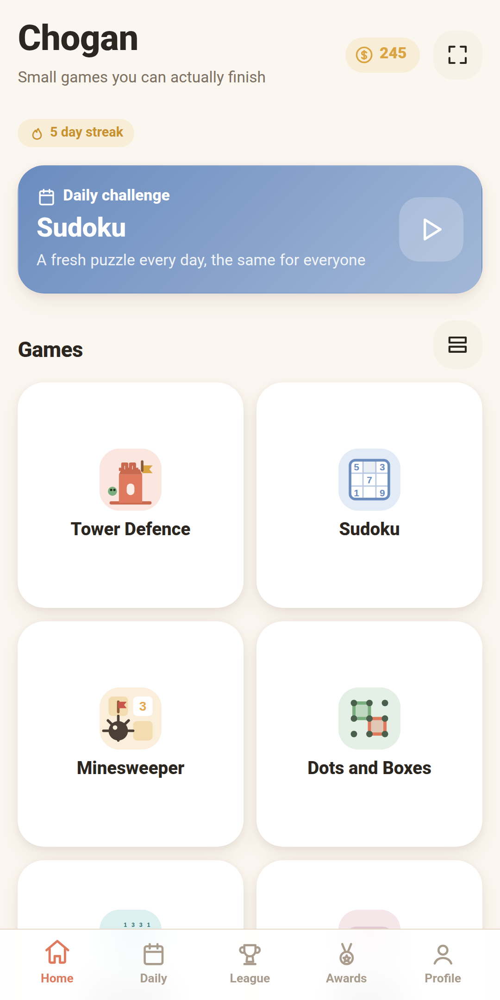
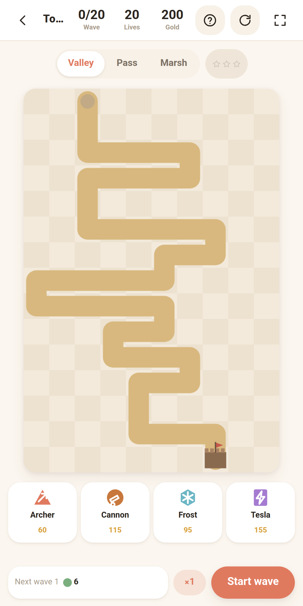
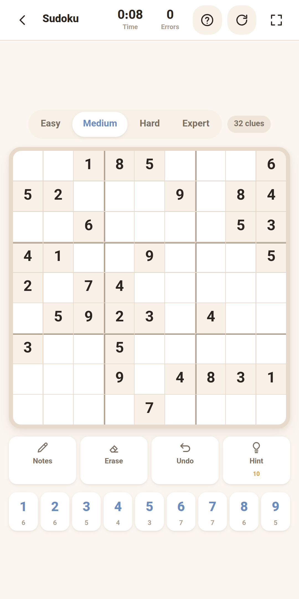
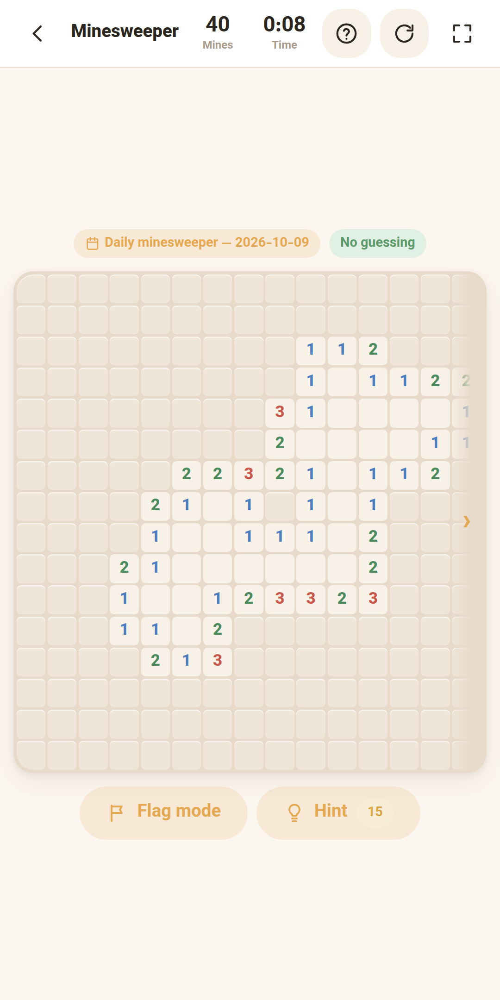
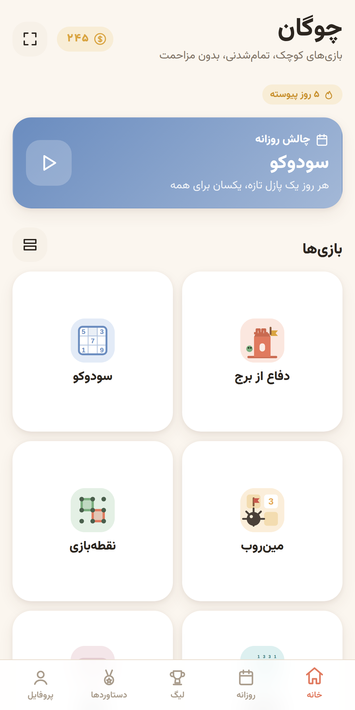
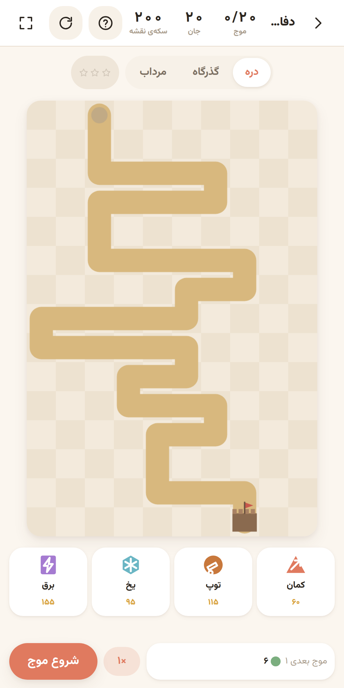
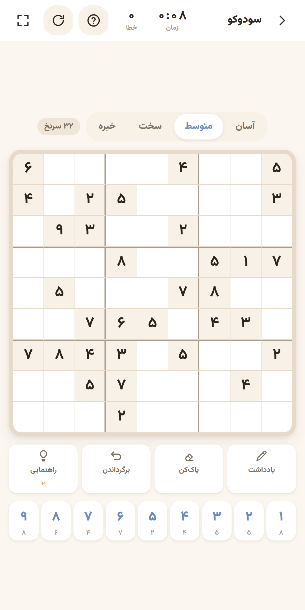
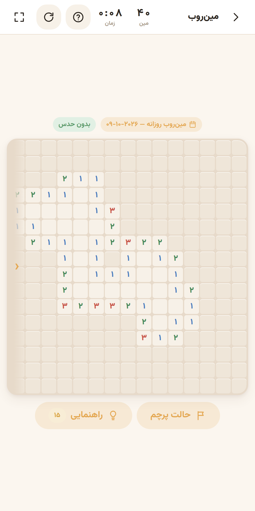

# Chogan — چوگان

## English

Chogan is a small collection of finishable games in a single app. Free, open source, no ads, no in-app purchases, no analytics or trackers, and fully offline.

Ways to play:
- **Web:** [playchogan.com](https://playchogan.com) (it opens [choganhq.github.io/chogan](https://choganhq.github.io/chogan/)), installable as an app from the browser.
- **Android:** [F-Droid](https://f-droid.org/packages/io.github.choganhq.chogan/), or the APK on the [Releases page](https://github.com/choganhq/chogan/releases).
- **Telegram:** [@chogangamebot](https://t.me/chogangamebot) opens the web version inside Telegram.
- **News:** every release is announced in the Telegram channel [@chogan_games](https://t.me/chogan_games).

<p>




</p>

### The games

Every game, with a line about each: [GAMES.md](GAMES.md#english).

Around the games: search by name, pinned and recently played games and a row of new ones at the top of the menu, long-press shortcuts to games on the app icon, a daily challenge that is identical on every device with no server at all, a weekly offline league with five tiers, over 150 awards, a shared coin that is only ever spent on hints and cosmetics, stats and a profile, and a Persian, English, Simplified Chinese, German, Spanish and Polish interface with light and dark themes.

### Why Chogan

Chogan (چوگان) is the Persian name of the game known today as polo: a team game on horseback, where the ball is struck towards the goal with a crooked stick, itself called a chogan. It is one of the oldest team games and was played in Iran for centuries; the stone goalposts still stand in Naqsh-e Jahan Square in Isfahan. We chose the name because it is an Iranian name, and because chogan, for all its simplicity, just a stick and a ball, can be a real challenge. That is what the games in this app want to be.

### Why it needs no permissions

The Android manifest declares `VIBRATE` and nothing else — not even internet access, because nothing in the app ever touches the network. Fonts, sounds and every asset ship inside the package; sound is generated procedurally with WebAudio, so there is not a single audio file in the build. Progress is stored on the device only, and Google auto-backup is turned off.

### Building

The web version needs no build step:

```bash
python3 -m http.server -d www 8000
```

For a clean browser with no progress or service worker cache left over from an earlier run, use `tools/dev.sh`. It serves the same files, opens Chrome with a throwaway profile that is deleted when you close it, and never writes into `www/`. `tools/dev.sh --seed` also skips the first-run welcome and adds invented demo state.

The Android version needs Gradle only — no Node, no npm, no `node_modules`:

```bash
cd android && gradle assembleDebug
```

Capacitor's runtime is pulled from Maven Central as `com.capacitorjs:core`, and a Gradle task named `syncWebAssets` replaces `npx cap sync`.

### Testing

```bash
node tools/test.js
tools/browser-check.sh
```

The tests extract each game engine from the published HTML file itself, between the `ENGINE START` and `ENGINE END` markers, so no second copy of the code exists for testing.

### Adding a game

See [NEW_GAME.md](NEW_GAME.md). In short: one folder under `www/games/`, one entry in `games.json`, bump the version.

### Both sources ship the same signed APK

Chogan is published on F-Droid as a [reproducible build](https://f-droid.org/docs/Reproducible_Builds). F-Droid rebuilds it from source, compares the result to the APK attached to the GitHub release, and when they match it publishes **our** signed file rather than re-signing with its own key.

So both sources carry the identical, identically-signed APK. You can install from either one and switch later without uninstalling, and your progress survives.

### License

MIT, see [LICENSE](LICENSE). The Vazirmatn font, the Latin subset of Nunito and the Devanagari subset of Noto Sans Devanagari are under the OFL; their licence texts ship beside the fonts in `www/fonts/OFL.txt`, `www/fonts/OFL-Nunito.txt` and `www/fonts/OFL-NotoSansDevanagari.txt`.

---

<div dir="rtl">

## فارسی

مجموعه‌بازی چوگان: چند بازی کوچک و تمام‌شدنی در یک اپ. رایگان، متن‌باز، بدون تبلیغ، بدون خرید درون‌برنامه‌ای، بدون تحلیل‌گر و ردیاب، و کاملاً آفلاین.

راه‌های بازی:
- **وب:** [playchogan.com](https://playchogan.com) (که [choganhq.github.io/chogan](https://choganhq.github.io/chogan/) را باز می‌کند)، و از مرورگر مثل یک اپ نصب می‌شود.
- **اندروید:** از [اف‌دروید](https://f-droid.org/packages/io.github.choganhq.chogan/)، یا فایل APK از بخش [Releases](https://github.com/choganhq/chogan/releases).
- **تلگرام:** [@chogangamebot](https://t.me/chogangamebot) نسخه‌ی وب را داخل تلگرام باز می‌کند.
- **خبرها:** هر نسخه‌ی تازه در کانال تلگرام [@chogan_games](https://t.me/chogan_games) (به انگلیسی) اعلام می‌شود.

<p>




</p>

### بازی‌ها

همه‌ی بازی‌ها، هر کدام با یک خط توضیح: [GAMES.md](GAMES.md#فارسی).

بیرون از بازی‌ها: جست‌وجوی بازی با نام، بازی‌های سنجاق‌شده، اخیراً بازی‌شده و ردیف بازی‌های تازه بالای منو، میان‌بر بازی‌ها با نگه داشتن آیکون اپ، چالش روزانه‌ی مشترک برای همه‌ی دستگاه‌ها بدون هیچ سروری، لیگ هفتگی آفلاین با پنج رده، بیش از ۱۵۰ دستاورد، سکه‌ی مشترک که فقط خرج راهنمایی و تزئینات می‌شود، آمار و پروفایل، و رابط فارسی، انگلیسی، چینی ساده‌شده، آلمانی، اسپانیایی و لهستانی با تم روشن و تاریک.

### چرا چوگان

چوگان نام فارسی بازی‌ای است که امروز بیشتر با نام پولو می‌شناسند: بازی گروهی سوار بر اسب که توپ را با چوبی سرکج، که آن هم چوگان نام دارد، به دروازه می‌زنند. از کهن‌ترین بازی‌های گروهی است و قرن‌ها در ایران بازی شده؛ دروازه‌های سنگی چوگان هنوز در میدان نقش جهان اصفهان پابرجاست. این نام را برگزیدیم چون نامی ایرانی است، و چون چوگان با همه‌ی سادگی‌اش، فقط یک چوب و یک توپ، می‌تواند چالشی واقعی باشد؛ همان چیزی که بازی‌های این اپ می‌خواهند باشند.

### چرا هیچ مجوزی نمی‌خواهد

منیفست اندروید فقط `VIBRATE` دارد و بس. حتی مجوز اینترنت هم اعلام نشده، چون هیچ‌جای اپ به شبکه وصل نمی‌شود: فونت، صدا، تصویر و همه‌ی دارایی‌ها داخل بسته‌اند. صداها با WebAudio به‌صورت رویه‌ای ساخته می‌شوند، پس حتی یک فایل صوتی هم در بسته نیست. پیشرفت فقط روی خود دستگاه ذخیره می‌شود و بکاپ خودکار گوگل هم خاموش است.

### ساختار

```
capacitor.config.json      تنها منبع شناسه و نام بسته
www/
  index.html               منوی اصلی با پنج زبانه
  games.json               تنها منبع فهرست بازی‌ها؛ منو و سرویس‌ورکر هر دو از آن می‌خوانند
  version.js               تنها منبع نسخه برای وب و اندروید
  sw.js                    سرویس‌ورکر آفلاین، کش-اول
  lib/chogan.css           سیستم طراحی: توکن‌های رنگ و شعاع و سایه و فاصله
  lib/chogan.js            هسته‌ی مشترک همه‌ی بازی‌ها
  fonts/                   وزیرمتن، حروف لاتین نونیتو و حروف دوناگری نوتو، داخل بسته
  games/<id>/              هر بازی یک پوشه: index.html و icon.svg
android/                   پروژه‌ی اندروید، فقط یک فایل جاوا
template/game/             اسکلت بازی جدید
tools/                     تست خودکار موتورها و بررسی مرورگر
fastlane/metadata/         متادیتای اف‌دروید، سه‌زبانه
```

### اجرای محلی

نسخه‌ی وب هیچ بیلدی ندارد:

```bash
python3 -m http.server -d www 8000
```

برای مرورگری بدون پیشرفت یا کش سرویس‌ورکرِ مانده از اجرای قبل، `tools/dev.sh` را بزن. همان فایل‌ها را سرو می‌کند، کروم را با پروفایل موقتی باز می‌کند که با بستنش پاک می‌شود، و چیزی داخل `www/` نمی‌نویسد. `tools/dev.sh --seed` خوشامد اولین اجرا را هم رد می‌کند و داده‌ی نمایشی ساختگی می‌گذارد.

نسخه‌ی اندروید فقط گریدل لازم دارد. نه نود، نه npm، نه `node_modules`:

```bash
cd android && gradle assembleDebug
```

هسته‌ی کپسیتور به‌صورت `com.capacitorjs:core` از Maven Central می‌آید و تسک گریدل `syncWebAssets` جای `npx cap sync` را گرفته است.

### تست

```bash
node tools/test.js        # موتور همه‌ی بازی‌ها، از دل همان فایل‌های منتشرشده
tools/browser-check.sh    # منو و همه‌ی بازی‌ها در کروم بدون سر
```

تست‌ها موتور را بین دو نشانه‌ی `ENGINE START` و `ENGINE END` از خود فایل HTML بیرون می‌کشند، پس هیچ‌وقت نسخه‌ی دومی از کد برای تست وجود ندارد. چیزهایی که واقعاً سنجیده می‌شوند: یکتا بودن جواب سودوکو، بدون حدس بودن تخته‌ی مین‌روب، قوی‌تر بودن هوش سخت نقطه‌بازی از متوسط، و بردنی ولی نه آسان بودن دفاع از برج.

### بازی جدید

[NEW_GAME.md](NEW_GAME.md) را ببین. خلاصه‌اش: یک پوشه زیر `www/games/`، یک ورودی در `games.json`، بالا بردن نسخه.

### انتشار

```bash
# نسخه را در www/version.js بالا ببر، چنج‌لاگ را در fastlane بنویس، بعد:
git tag v0.2.0 && git push origin v0.2.0
```

بقیه‌اش خودکار است: APK امضاشده ساخته می‌شود، امضایش تأیید می‌شود و همراه فایل چک‌سام به Releases می‌رود. هر تگی که به `-test` ختم شود بیلد آزمایشی است: از قید هم‌خوانی تگ با نسخه معاف و به‌صورت pre-release منتشر می‌شود.

سکرت‌های امضا در سطح سازمان `choganhq` تعریف شده‌اند: `ANDROID_KEYSTORE_BASE64` و `ANDROID_KEYSTORE_PASSWORD` و `ANDROID_KEY_ALIAS` و `ANDROID_KEY_PASSWORD`.

### هر دو منبع یک فایل امضاشده می‌دهند

چوگان روی اف‌دروید به شکل [بیلد تکرارپذیر](https://f-droid.org/docs/Reproducible_Builds) منتشر می‌شود. اف‌دروید از روی سورس دوباره بیلد می‌گیرد، نتیجه را با APK پیوست‌شده به انتشار گیت‌هاب مقایسه می‌کند، و چون یکی درمی‌آیند همان فایل امضاشده‌ی **ما** را منتشر می‌کند نه نسخه‌ای با کلید خودش.

پس هر دو منبع دقیقاً یک فایل با یک امضا می‌دهند. از هرکدام خواستی نصب کن و هر وقت خواستی منبعت را عوض کن؛ لازم نیست اپ را حذف کنی و پیشرفتت هم می‌ماند.

### مجوز

MIT. متن کامل در [LICENSE](LICENSE). فونت وزیرمتن، زیرمجموعه‌ی لاتین نونیتو و زیرمجموعه‌ی دوناگری Noto Sans Devanagari زیر مجوز OFL هستند، متنشان کنار خود فونت‌ها در `www/fonts/OFL.txt`، `www/fonts/OFL-Nunito.txt` و `www/fonts/OFL-NotoSansDevanagari.txt`.

</div>
